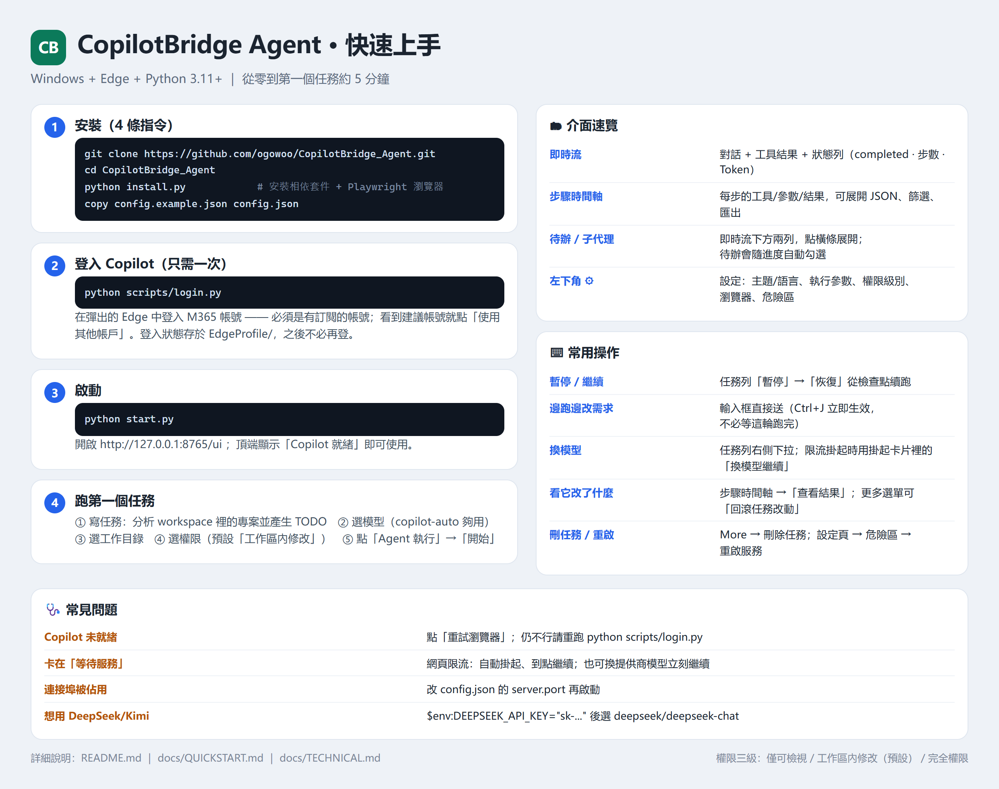
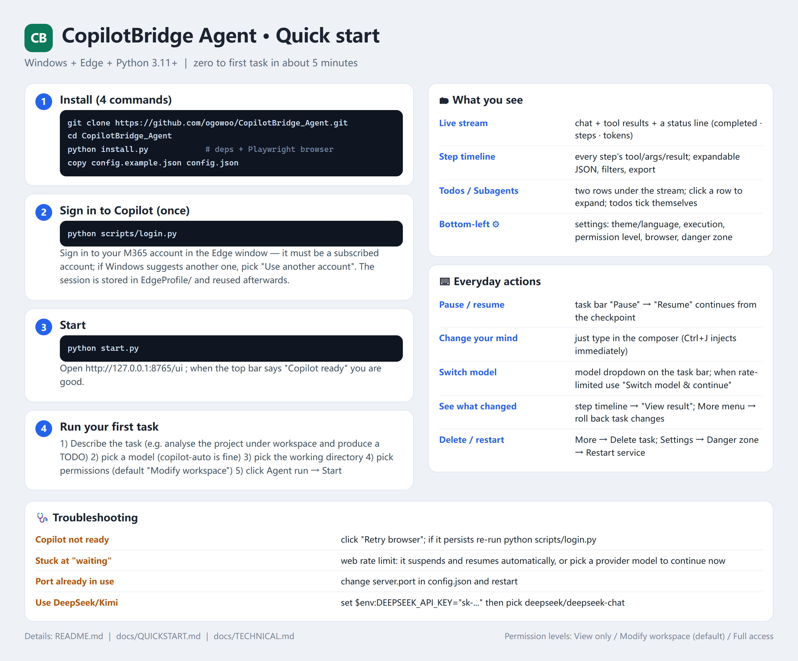

# 快速使用手册（一页版）

> 目标：**5 分钟内**从零跑到第一个任务。更细的说明看 [README](../README.md)。

## 一页图（可直接保存/转发）

| 简体中文 | 繁體中文 | English |
|---|---|---|
|  |  |  |

- 简体：[quickstart-zh.png](quickstart-zh.png)
- 繁體：[quickstart-zh-TW.png](quickstart-zh-TW.png)
- English：[quickstart-en.png](quickstart-en.png)

> 图由 `python scripts/make_quickstart_card.py` 生成（改文案后重跑即可）。

## 1. 准备

- Windows 10/11（其他系统把 `config.json` 的 `browser_channel` 改成 `chrome`）
- Microsoft Edge（已登录能访问 Copilot 的账号）
- **Python 3.11+**（`python -V` 确认）

## 2. 安装（4 条命令）

```powershell
git clone https://github.com/ogowoo/Gantry.git
cd Gantry
python install.py                                   # 装依赖 + Playwright 浏览器
copy config.example.json config.json                 # 首次需要
```

## 3. 登录 Copilot（只做一次）

```powershell
python scripts/login.py
```

弹出的 Edge 窗口里登录你的 M365 账号（**必须用有订阅的账号**，看到推荐账号就点「使用其他账户」），
确认能打开 Copilot 聊天页后，回到命令行按回车。

登录态存在 `EdgeProfile/`，之后不用再登。

## 4. 启动

```powershell
python start.py
```

浏览器打开 **http://127.0.0.1:8765/ui** ，顶部状态显示 `Copilot 就绪` 即可用。
（`Copilot 未就绪` 就点界面右上「重试浏览器」，或在自动化窗口里重新登录。）

## 5. 跑第一个任务

在首页输入框里：

1. **写任务**：`分析 workspace 里的项目并生成 TODO`
2. **选模型**（左下）：`copilot-auto` 够用；要更强的推理选 `Think deeper`
3. **选目录**：`工作目录` 填相对路径（默认 `workspace`）
4. **选权限**：`🛠 工作区内修改`（默认）——只改工作区文件；改不了就换 `⚠ 完全权限`
5. **点「Agent 执行」→「开始」**

## 6. 界面速览

| 在哪 | 看什么 |
|---|---|
| **实时流** | 对话、工具结果、当前状态一行（`completed · 步 388 · Token`） |
| **步骤时间线** | 每一步的工具/参数/结果，可展开 JSON，可筛选/导出 |
| **待办 / 子代理** | 实时流下方两条：点横条展开；待办会随进度自动勾选 |
| **左下角 ⚙** | 设置：主题/语言、执行参数、权限档位、浏览器、危险区（重启/终止） |

## 7. 常用操作

| 想做的事 | 怎么做 |
|---|---|
| 暂停 / 继续 | 任务条上「暂停」；再点「恢复」从检查点续跑 |
| 中途改要求 | 输入框直接发消息（Ctrl+J 可边跑边插入，立即生效） |
| 换模型 | 任务条右侧模型下拉；限流挂起时挂起卡片里可「换模型继续」 |
| 看它到底改了什么 | 步骤时间线 → 该步「查看结果」；更多菜单里有「回滚任务改动…」 |
| 删任务 | 任务条「More → 删除任务」（会问要不要连 Copilot 网页记录一起删） |
| 重启服务 | 设置页「危险区 → 重启服务」（正在跑的任务会中断，可恢复） |

## 8. 常见问题

| 现象 | 处理 |
|---|---|
| `Copilot 未就绪 / 需要登录` | 点「重试浏览器」；仍不行就重跑 `python scripts/login.py` |
| 任务卡在「等待服务」 | Copilot 网页限流：会自动挂起、到点继续；也可在挂起卡片里换提供商模型立刻继续 |
| 端口被占用 | `config.json` 的 `server.port` 改个值再启动 |
| 想用 DeepSeek/Kimi/OpenAI | 设环境变量（如 `$env:DEEPSEEK_API_KEY="sk-..."`）后，模型列表里会出现 `deepseek/deepseek-chat` |

## 9. 可选：当 OpenAI 接口用

```python
from openai import OpenAI
client = OpenAI(base_url="http://127.0.0.1:8765/v1", api_key="unused")
print(client.chat.completions.create(
    model="copilot-auto",
    messages=[{"role": "user", "content": "你好"}],
).choices[0].message.content)
```

---

需要更深的配置（自升级、审批门、技能、工作区策略）→ [README](../README.md)、[技术说明](TECHNICAL.md)。
